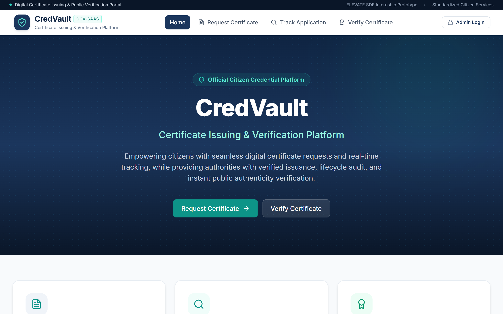
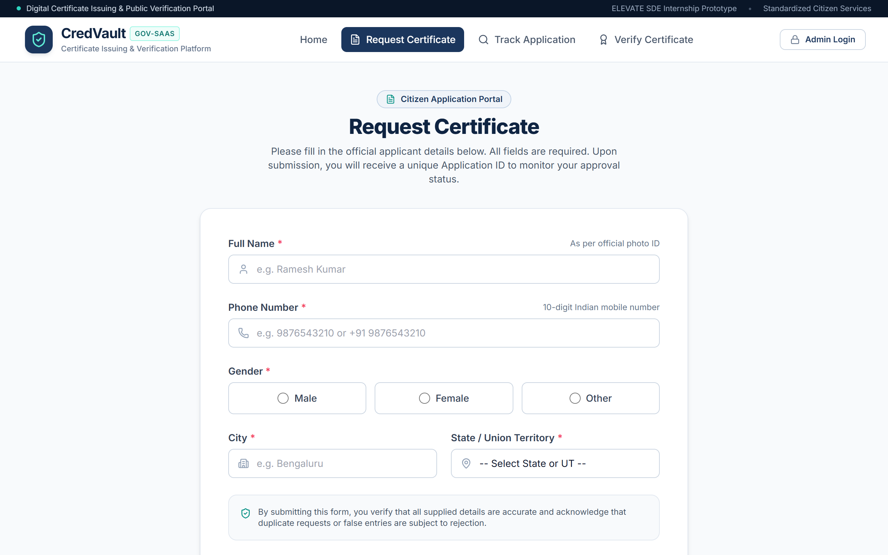
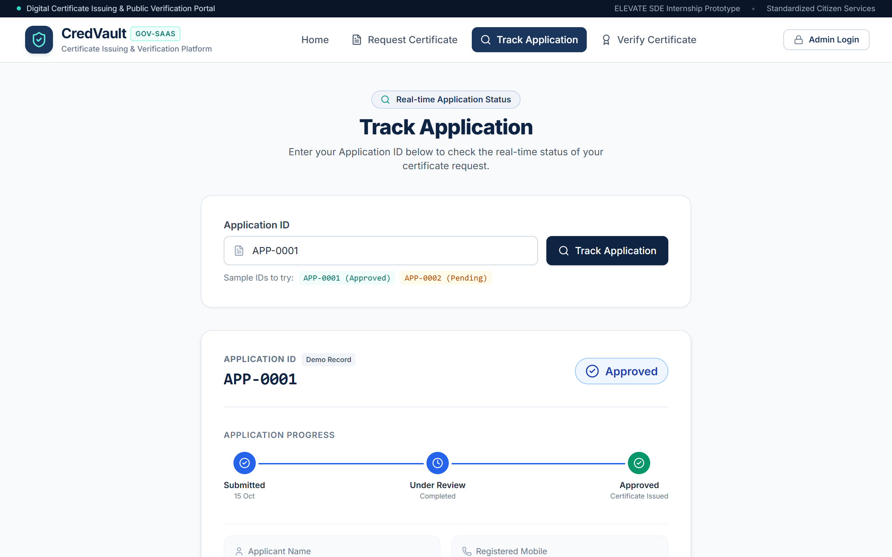
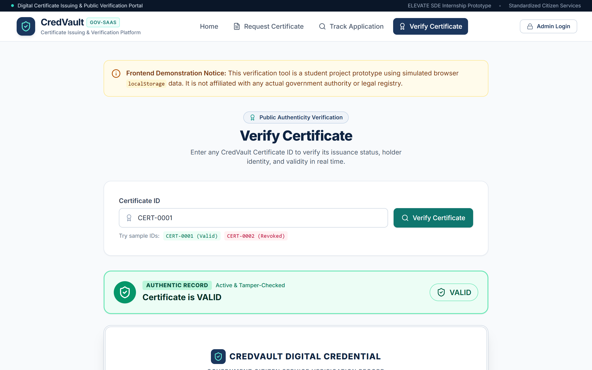
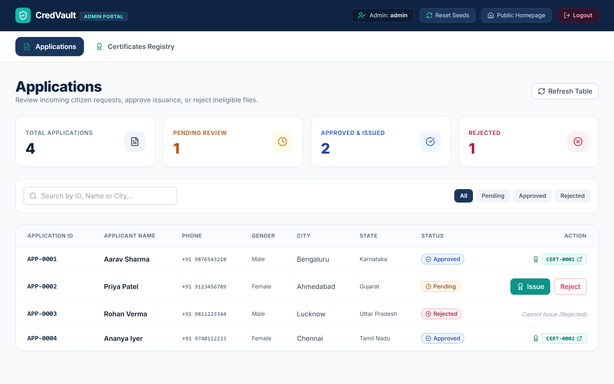

# CredVault — Certificate Issuing & Verification Platform
### ELEVATE SDE Internship — Task 2 Frontend Prototype

[](https://vitejs.dev/)
[](https://react.dev/)
[](https://tailwindcss.com/)
[](https://reactrouter.com/)
[](https://opensource.org/licenses/MIT)

---

## 1. Project Overview

**CredVault** is a digital certificate issuing and verification platform prototype modeled after modern digital government citizen services (such as DigiLocker and National Portal systems). 

The application facilitates a complete lifecycle for citizen credentials:
- **Citizens** can submit formal certificate requests with Indian domicile and mobile validation, monitor application progress via unique Application IDs (`APP-XXXX`), and verify the authenticity of issued certificates (`CERT-XXXX`).
- **Administrators** can authenticate via a protected portal to inspect application queues, approve and issue sequential digital certificates, or reject applications with recorded remarks. Additionally, administrators can revoke active certificates with immediate synchronization across public verification channels.

> **Important Architecture Notice:** This is a **frontend-only** implementation engineered specifically for the ELEVATE SDE Internship Task 2 evaluation. It relies on browser `localStorage` and `sessionStorage` with zero external backend, database, or paid third-party API dependencies. The business logic is structured into distinct service layers (`storageService.js` and `idService.js`) to enable seamless migration to a REST or GraphQL backend in the future.

---

## 2. Key Objectives & Features

### Citizen Experience
- **Home Landing Portal (`/`)**: High-impact government SaaS aesthetic featuring brand mission, quick action cards, and architectural highlights.
- **Certificate Request Engine (`/request`)**:
  - Full Name, 10-digit Indian mobile validation (with optional `+91`), gender selection, city, and a comprehensive state dropdown containing all **28 Indian States and 8 Union Territories**.
  - Client-side validation ensuring non-empty, non-whitespace-only, and format-compliant inputs with inline error messaging.
  - Automatic generation of sequential Application IDs (e.g., `APP-0005`) with audit timestamp and initial `Pending` status.
  - Interactive success modal with direct shortcuts to track the application or submit additional requests.
- **Application Tracking (`/track`)**:
  - Case-insensitive, whitespace-trimmed lookup for any Application ID.
  - Visual 3-stage progress indicator (`Submitted` &rarr; `Under Review` &rarr; `Approved / Rejected`).
  - Clear "Application not found" handling for unknown records.
  - Direct deep-link to verify the certificate once issued.
- **Certificate Verification (`/verify`)**:
  - Instant public certificate authenticity lookup by Certificate ID (e.g., `CERT-0001`).
  - Distinct colored indicator badges: **VALID** (emerald green) and **REVOKED** (rose red).
  - High-fidelity printable digital certificate preview with official seal border, metadata grid, and digital signature hash.

### Administrator Experience
- **Demo Authentication (`/admin/login`)**:
  - Clean login card with username, password, show/hide password toggle, and validation.
  - Session-based authentication stored in `sessionStorage` (with one-click demo credentials auto-fill).
- **Applications Management (`/admin/applications`)**:
  - Protected route redirecting unauthenticated visitors to login.
  - Real-time summary cards: **Total**, **Pending**, **Approved**, and **Rejected**.
  - Search by applicant name, Application ID, or city, combined with status filtering tabs.
  - **Issue Action**: Promotes application to `Approved` and mints a unique Certificate ID (`CERT-XXXX`) with synchronized records. Prevents duplicate issuance.
  - **Reject Action**: Opens an accessible confirmation modal with optional remark capture. Permanently locks the application from certificate issuance.
- **Certificates Registry (`/admin/certificates`)**:
  - Real-time summary cards: **Total Issued**, **Active & Valid**, and **Revoked**.
  - Registry search and status filtering (All, Valid, Revoked).
  - **Revoke Action**: Confirmation modal allowing administrative revocation with reason logging. Immediate propagation to public verification screen.
- **One-Click Demo Reset**: Reset button available in header and footer to restore sample records anytime during testing.

---

## 3. Technology Stack

| Layer | Technology | Description |
| :--- | :--- | :--- |
| **Framework & Build** | React 19 + Vite 8 | Fast ESM bundling and component architecture |
| **Language** | JavaScript (ES6+) | Clean, modular functional components and hooks |
| **Styling** | Tailwind CSS v3.4 | Government-style navy blue (`#1b365d`) and teal (`#0d9488`) theme |
| **Routing** | React Router DOM v7 | Single-page client navigation with protected route guards |
| **Icons** | Lucide React | Clean, lightweight SVG iconography |
| **Storage & Persistence**| Browser `localStorage` / `sessionStorage` | Persistent demo records and session auth simulation |

---

## 4. Main Pages & Routes

| # | Route | Page Title | Access | Description |
| :-: | :--- | :--- | :-: | :--- |
| 1 | `/` | Home | Public | Platform overview, 3 main action cards, feature highlights |
| 2 | `/request` | Request Certificate | Public | Citizen submission form with 28 States & 8 UTs dropdown |
| 3 | `/track` | Track Application | Public | Search application status with progress stepper and auto-fill |
| 4 | `/verify` | Verify Certificate | Public | Validate certificate authenticity; displays VALID / REVOKED status |
| 5 | `/admin/login` | Admin Login | Public | Administrative login card with demo credentials |
| 6 | `/admin/applications` | Applications | Protected | Review submissions, issue certificates, reject applications |
| 7 | `/admin/certificates` | Certificates | Protected | Search issued certificates, filter by status, revoke credentials |
| 8 | `*` | Page Not Found | Public | Standard 404 page with navigation fallback |

---

## 5. Project Folder Structure

```text
ELEVATE-SDE-Task-2/
├── screenshots/                       # Captured UI screenshots for Task 2 review
│   ├── home.png
│   ├── request.png
│   ├── track.png
│   ├── verify.png
│   ├── admin-login.png
│   ├── admin-applications.png
│   └── admin-certificates.png
├── src/
│   ├── components/                   # Reusable UI components
│   │   ├── AdminLayout.jsx           # Admin header, navigation tabs, and actions
│   │   ├── Button.jsx                # Multi-variant button (primary, teal, secondary, danger)
│   │   ├── ConfirmModal.jsx          # Accessible confirmation dialog for reject/revoke
│   │   ├── Footer.jsx                # Official footer with reset demo data action
│   │   ├── FormField.jsx             # Accessible input wrapper with inline validation errors
│   │   ├── Navbar.jsx                # Top banner, brand emblem, public navigation & mobile drawer
│   │   ├── ProtectedRoute.jsx        # Route guard checking admin session authentication
│   │   └── StatusBadge.jsx           # Unified badge (Pending, Approved, Rejected, Valid, Revoked)
│   ├── data/
│   │   ├── demoData.js               # Initial sample applications & certificates
│   │   └── indianStates.js           # Exact 28 States & 8 Union Territories
│   ├── pages/
│   │   ├── AdminApplications.jsx     # Admin queue, issue & reject workflows
│   │   ├── AdminCertificates.jsx     # Admin certificates table and revoke workflow
│   │   ├── AdminLogin.jsx            # Admin login card with demo auto-fill
│   │   ├── Home.jsx                  # Public landing page with hero & action cards
│   │   ├── NotFound.jsx              # 404 error page
│   │   ├── RequestCertificate.jsx    # Application form with Indian phone & state validation
│   │   ├── TrackApplication.jsx      # Tracking lookup & visual progress timeline
│   │   └── VerifyCertificate.jsx     # Public verification & certificate print view
│   ├── services/
│   │   ├── idService.js              # Unique sequential ID generator (APP-XXXX, CERT-XXXX)
│   │   └── storageService.js         # Centralized localStorage & sessionStorage abstraction
│   ├── App.jsx                       # Router configuration and layout composition
│   ├── index.css                     # Tailwind directives and utility classes
│   └── main.jsx                      # React 19 application entry point
├── index.html                        # HTML template with Google Fonts (Inter) and favicon
├── package.json                      # Project dependencies and npm scripts
├── postcss.config.js                 # PostCSS config for Tailwind CSS
├── tailwind.config.js                # Custom navy-blue and teal design system tokens
├── vite.config.js                    # Vite configuration
└── README.md                         # Documentation and submission report
```

---

## 6. Demo Credentials & Sample Records

### Admin Login Credentials
- **Username:** `admin`
- **Password:** `admin`

> Click the **"Auto-Fill"** button on `/admin/login` to populate these credentials instantly.

### Seeded Sample Records
The application initializes with realistic sample data on first launch without overwriting any new user data:

| Record Type | ID | Holder / Applicant | Status | Notes |
| :--- | :--- | :--- | :--- | :--- |
| **Application** | `APP-0001` | Aarav Sharma | `Approved` | Linked to Certificate `CERT-0001` |
| **Application** | `APP-0002` | Priya Patel | `Pending` | Ready for testing **Issue** or **Reject** in Admin |
| **Application** | `APP-0003` | Rohan Verma | `Rejected` | Demonstrates rejected state & issuance lock |
| **Application** | `APP-0004` | Ananya Iyer | `Approved` | Linked to Certificate `CERT-0002` |
| **Certificate** | `CERT-0001` | Aarav Sharma | `Valid` | Tests public **VALID** green indicator badge |
| **Certificate** | `CERT-0002` | Ananya Iyer | `Revoked` | Tests public **REVOKED** red indicator badge |

---

## 7. Prerequisites & Local Installation

### Prerequisites
- **Node.js**: Version 18.x or higher (tested on Node v25.x)
- **npm**: Version 9.x or higher

### Installation Steps

1. **Clone the repository:**
   ```bash
   git clone https://github.com/YOUR_USERNAME/ELEVATE-SDE-Task-2.git
   cd ELEVATE-SDE-Task-2
   ```

2. **Install project dependencies:**
   ```bash
   npm install
   ```

3. **Start the local development server:**
   ```bash
   npm run dev
   ```

4. **Open in browser:**
   Open [http://localhost:5173](http://localhost:5173) in your web browser.

5. **(Optional) Build production bundle:**
   ```bash
   npm run build
   npm run preview
   ```

---

## 8. Data Storage Architecture & Future Backend Integration

### Current Local Simulation Architecture
```text
Citizen Form / Admin Action
           │
           ▼
   storageService.js  ◄──►  idService.js (Unique ID calculation)
           │
     ┌─────┴──────────────┐
     ▼                    ▼
localStorage         sessionStorage
(Apps & Certs)       (Admin Auth Flag)
```

- **Persistence**: All applications and certificates are stored under `credvault_applications` and `credvault_certificates` keys in browser `localStorage`. Refreshing or reopening the browser preserves all state.
- **Safety**: Demo data is seeded only when keys are missing. Corrupted JSON data is handled gracefully with safe fallbacks.
- **Synchronization**: Approving an application automatically generates a certificate, marks the certificate as `Valid`, and assigns the Certificate ID to the application. Revoking a certificate immediately updates both the admin registry and the public verification portal.

### Limitations & Future Backend Roadmap
1. **Security**: Client-side storage and credentials (`admin`/`admin`) are solely for frontend prototype simulation. In production, this would be backed by JSON Web Tokens (JWT) / OAuth 2.0 with HTTP-only cookies.
2. **Data Concurrency**: Local storage is isolated to the user's browser profile. In production, a PostgreSQL or MongoDB database with a Node.js / Express or Python / FastAPI backend will support multi-tenant persistence.
3. **Cryptographic Signatures**: The prototype simulates digital verification hashes (`SHA256-CERT-XXXX`). Production implementation can integrate an asymmetric PKI signature scheme (RSA/Ed25519) and QR code scanning.

---

## 9. Page Screenshots

All seven primary pages have been captured from the working application:

### 1. Home (`/`)


---

### 2. Request Certificate (`/request`)


---

### 3. Track Application (`/track`)


---

### 4. Verify Certificate (`/verify`)


---

### 5. Admin Login (`/admin/login`)


---

### 6. Admin Applications (`/admin/applications`)


---

### 7. Admin Certificates (`/admin/certificates`)


---

## 10. Verification & Quality Checklist

- [x] Responsive layout across desktop, tablet, and mobile screens.
- [x] Government-service design system: navy blue (`#1b365d`) with subtle teal accents.
- [x] Clean white and light-gray backgrounds, soft shadows, readable typography.
- [x] Standardized colored status badges (`Pending`, `Approved`, `Rejected`, `Valid`, `Revoked`).
- [x] Exactly 28 Indian States and 8 Union Territories in State dropdown.
- [x] 10-digit Indian mobile number validation with optional `+91`.
- [x] Dynamic sequential ID generation (`APP-0001`, `CERT-0001`, etc.).
- [x] Case-insensitive, whitespace-trimmed tracking and verification lookups.
- [x] Admin login with session authentication (`admin` / `admin`).
- [x] Protected admin routes redirecting unauthenticated users to `/admin/login`.
- [x] Immediate state synchronization between application issuing and certificate creation.
- [x] Revocation confirmation dialog with immediate public reflection.
- [x] Rejection locks application from receiving certificates.
- [x] Fully functioning 404 Not Found page.
- [x] Clean zero-error production build.

---

## 11. Author

**Candidate:** ELEVATE SDE Internship Candidate  
**Project:** CredVault — Certificate Issuing & Verification Platform  
**Task:** ELEVATE SDE Internship Task 2
